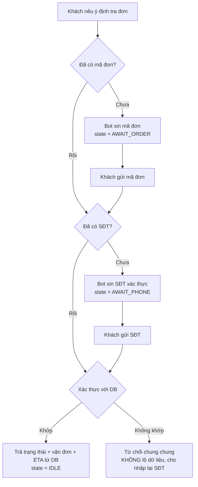

# Activity + Sequence — Luồng tra cứu đơn hàng có xác thực

## Activity


## Sequence
```mermaid
sequenceDiagram
    participant K as Khách
    participant W as Widget chat
    participant API as FastAPI
    participant E as Dialogue Engine
    participant DB as SQLite
    K->>W: "kiểm tra đơn TZ100001"
    W->>API: POST /api/chat (session_id, message)
    API->>E: chat(session, message)
    E->>E: classify intent = tra_don_hang; entity: order_code
    E->>DB: lưu pending_order, state = AWAIT_PHONE
    E-->>K: "Cho mình xin SĐT để xác thực"
    K->>W: "0901234567"
    W->>API: POST /api/chat (cùng session_id)
    API->>E: chat(...)
    E->>DB: SELECT order TZ100001
    DB-->>E: order(phone = 0901234567, status = SHIPPING...)
    E->>E: SĐT khớp -> được phép trả dữ liệu
    E-->>K: Trạng thái + mã vận đơn + ETA (từ DB)
```
