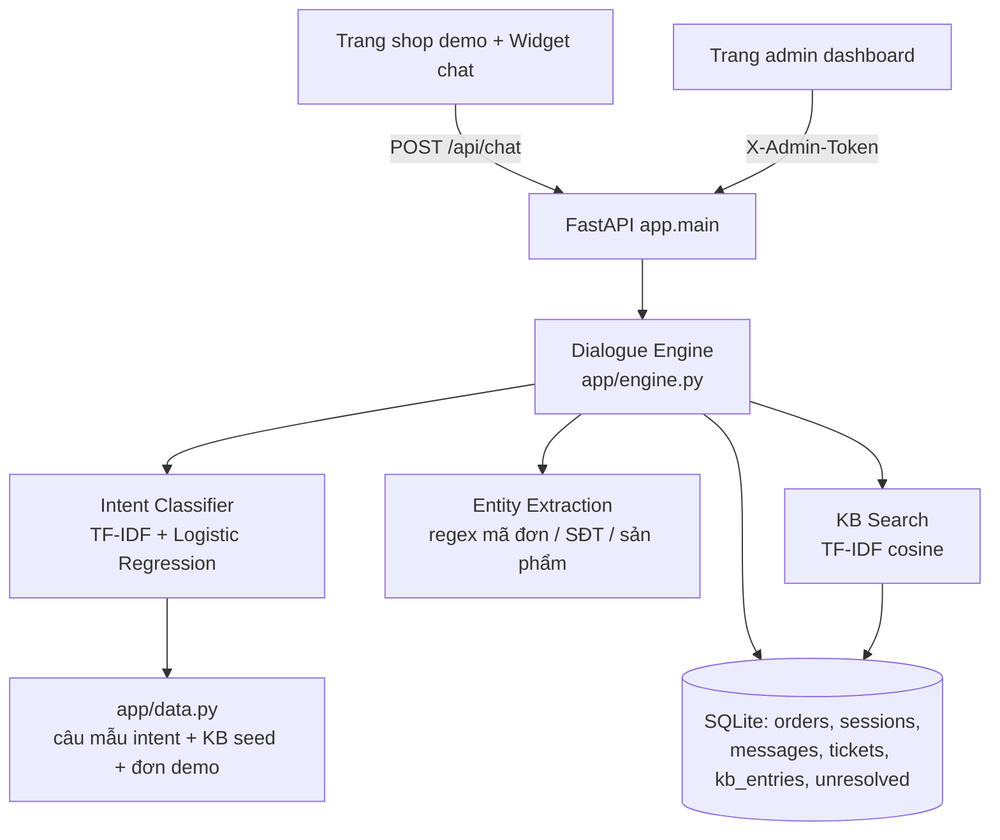

# Architecture

## Thành phần
| Module | Vai trò |
|---|---|
| `app/data.py` | Dữ liệu mẫu: 14 intent + câu mẫu, 17 mục KB seed, 14 đơn hàng demo, danh sách sản phẩm |
| `app/classifier.py` | Chuẩn hóa tiếng Việt, TF-IDF vectorizer, Logistic Regression (confidence = predict_proba), KB cosine search, trích xuất entity |
| `app/engine.py` | Máy trạng thái hội thoại (IDLE → AWAIT_ORDER → AWAIT_PHONE → xác thực), fallback/handoff/ticket |
| `app/db.py` | SQLite + seed tự động lần chạy đầu |
| `app/main.py` | REST API chat + admin, phục vụ frontend tĩnh |
| `static/index.html` | Shop demo + widget chat (mở/đóng, chips gợi ý, trạng thái đang gõ, báo lỗi kết nối) |
| `static/admin.html` | Dashboard: KPI, intent phổ biến, câu chưa giải quyết, ticket, hội thoại, CRUD KB |

## Quyết định thiết kế
- **State machine tường minh thay vì chỉ dựa vào intent**: khi phiên đang ở AWAIT_ORDER/AWAIT_PHONE, entity trong tin nhắn được ưu tiên hơn intent mới — nhờ vậy khách chỉ cần gõ "0901234567" ở lượt sau mà bot vẫn hiểu đang xác thực đơn.
- **Confidence threshold 0.45**: dưới ngưỡng → fallback thay vì trả lời bừa.
- **KB tách khỏi câu mẫu intent**: admin sửa KB qua API là bot dùng ngay (reload vectorizer), không cần huấn luyện lại classifier.
