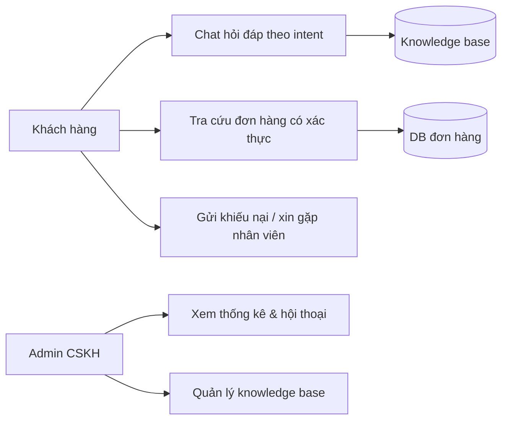

# Use Case

## Actors
- **Khách hàng**: chat, tra đơn, hỏi chính sách, khiếu nại, xin gặp nhân viên.
- **Admin/CSKH**: xem thống kê, hội thoại, ticket, câu chưa giải quyết; quản lý KB.
- **Hệ thống**: classifier, dialogue engine, DB đơn hàng.

## Đặc tả UC2 — Tra cứu đơn hàng (use case quan trọng nhất)
- **Điều kiện tiên quyết**: khách có mã đơn và SĐT đã dùng khi đặt hàng.
- **Luồng chính**: khách nêu ý định tra đơn → bot xin mã đơn → khách gửi mã → bot xin SĐT xác thực → khách gửi SĐT → khớp DB → bot trả trạng thái, sản phẩm, vận đơn, ETA từ DB.
- **Luồng thay thế**: khách cung cấp cả mã đơn + SĐT trong một câu → bot xác thực ngay.
- **Ngoại lệ**: mã đơn không tồn tại hoặc SĐT không khớp → bot trả lời chung "thông tin chưa khớp", không tiết lộ phần nào sai, không lộ bất kỳ dữ liệu đơn nào; khách được nhập lại.
